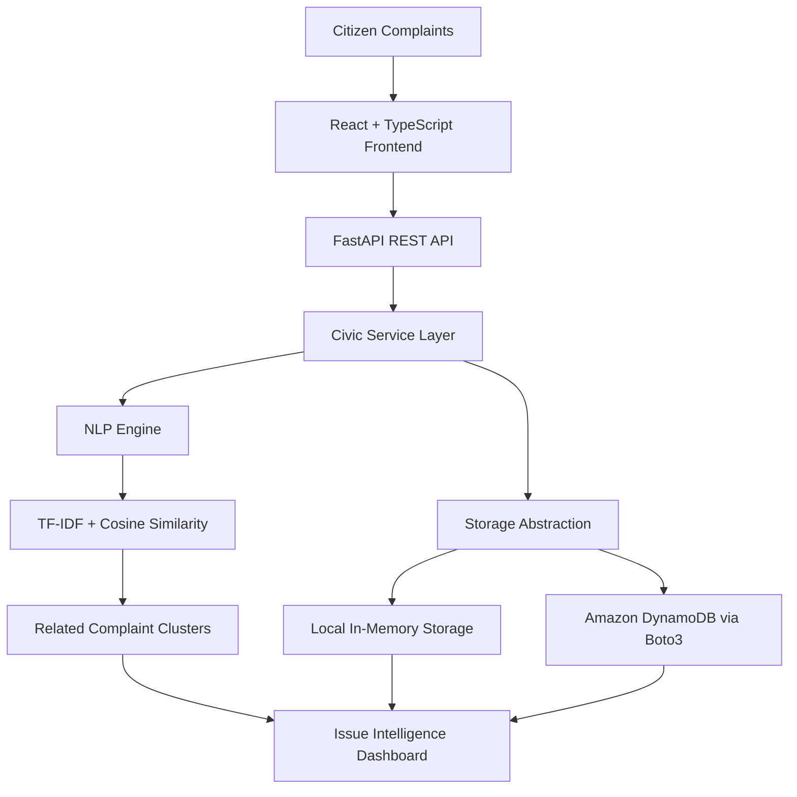

# 🏙️ CivicSignal — From Complaints to Community Intelligence

**Turning fragmented citizen complaints into actionable community-level insights using AI.**

CivicSignal is an AI-powered civic problem intelligence platform that identifies patterns across citizen complaints, groups related reports into underlying issues, and helps communities understand which problems may need attention first.

Instead of treating every complaint as an isolated ticket, CivicSignal aims to uncover the bigger problem behind multiple reports.

## 💡 The Problem

Citizens often report the same underlying issue in different ways:

- “There is no water in our street.”
- “The water tanker never arrived.”
- “Our school has no water.”

These reports may represent one larger **water supply disruption**, but handling them as separate complaints can make it harder to identify the scale and urgency of the problem.

Traditional complaint systems primarily collect individual reports. CivicSignal focuses on connecting related reports to reveal community-level problems.

## 🚀 Our Solution

CivicSignal processes citizen complaints and groups semantically related reports into potential civic issues.

The platform aims to help users:

- **Identify recurring problems:** Group related complaints into issue clusters.
- **Understand severity:** Surface issue severity and other prioritization signals.
- **Explore geographic patterns:** View reported locations associated with issues.
- **Estimate community impact:** Present estimated affected population where available.
- **Support better prioritization:** Provide issue summaries and recommended actions to guide further investigation.

> **Our vision:** Move civic technology beyond collecting complaints toward understanding the community problems behind them.

## ✨ Key Features

### 🧠 AI-assisted complaint clustering
Uses TF-IDF vectorization and cosine similarity to identify textual similarities between complaints and group related reports.

### 📊 Civic intelligence dashboard
Presents issue-level information such as report counts, locations, severity, status, and estimated impact.

### 🔎 Issue exploration
Allows users to inspect individual issues and understand the complaints contributing to them.

### 🎯 Action-oriented insights
Supports clearer issue prioritization and recommended next steps, depending on the available data and implementation.

### 🔌 Modular backend architecture
Separates civic application logic, NLP processing, and data storage so individual components can be maintained and extended independently.

### ☁️ AWS storage integration path
Includes a Boto3-based Amazon DynamoDB integration path, with local in-memory storage available for development and demonstrations. Live DynamoDB persistence requires valid AWS configuration and credentials.

## 🛠️ Technology Stack

| Component | Technologies |
|---|---|
| Frontend | React, TypeScript, Vite |
| Backend | Python, FastAPI |
| NLP | scikit-learn, TF-IDF, cosine similarity |
| API | REST APIs |
| AWS integration | Boto3, Amazon DynamoDB adapter |
| Testing | Pytest, frontend linting and production build |

## 🏗️ System Architecture



The local storage and DynamoDB paths are alternatives selected according to the configured environment; this diagram does not imply that both are active simultaneously.

## 🔄 How It Works

1. **Submit a complaint:** A user submits a civic complaint through the application.
2. **Process the report:** The FastAPI backend validates and processes the request.
3. **Analyze the text:** The NLP engine represents complaint text using TF-IDF and compares similarity using cosine similarity.
4. **Identify related reports:** Similar complaints can be grouped into potential underlying issues.
5. **Present issue intelligence:** The dashboard surfaces relevant issue information, including report counts and available impact indicators.
6. **Support prioritization:** Users can review the identified issues and use the available insights to determine what requires further attention.

*Note: TF-IDF and cosine similarity provide text-similarity signals; they do not independently establish that two complaints have the same real-world cause.*

## 📁 Project Structure

```text
ai-panchayat/
├── backend/
│   └── app/
│       ├── main.py
│       └── services/
│           ├── civic_service.py
│           ├── nlp_engine.py
│           └── dynamodb_store.py
│
├── frontend/
│   ├── src/
│   ├── package.json
│   └── ...
│
└── README.md
```

The structure above highlights the principal files and folders. Other project files may be present.

## ⚙️ Getting Started

### Prerequisites

- Python 3
- Node.js and npm
- Git

### 1. Clone the repository

```bash
git clone https://github.com/balanagasri/AI-Panchayath.git
cd AI-Panchayath
```

### 2. Start the backend

Open a terminal:

```bash
cd backend
python -m venv .venv
```

Activate the virtual environment on Windows:

```powershell
.venv\Scripts\Activate.ps1
```

Install the backend dependencies:

```bash
pip install -r requirements.txt
```

Start the FastAPI server:

```bash
python -m uvicorn app.main:app --reload --host 0.0.0.0 --port 8000
```

The backend should be available at:

- API base URL: `http://localhost:8000`
- Interactive API documentation: `http://localhost:8000/docs`
- Health check: `http://localhost:8000/health`

If the repository uses a different dependency file or environment configuration, follow the files included in the project.

### 3. Start the frontend

Open a second terminal:

```bash
cd frontend
npm install
npm run dev
```

Open the local URL printed by Vite, typically:

`http://localhost:5173`

Keep both development servers running while testing the application.

## 🔗 API Endpoints

The backend exposes the following application endpoints:

| Method | Endpoint | Purpose |
|---|---|---|
| GET | `/health` | Check backend health |
| POST | `/api/complaints` | Submit a complaint |
| GET | `/api/complaints` | Retrieve complaints |
| GET | `/api/issues` | Retrieve identified issues |
| GET | `/api/issues/{issue_id}` | Retrieve a specific issue |
| GET | `/api/dashboard` | Retrieve dashboard information |
| GET | `/api/aws-status` | Inspect the configured storage mode |

You can explore the request schemas, parameters, and responses through FastAPI's interactive documentation at `/docs`.

## ☁️ AWS Integration

CivicSignal includes a storage abstraction and a Boto3-based adapter for Amazon DynamoDB.

**Current implementation considerations:**

- Boto3 provides the Python SDK integration with AWS services.
- DynamoDB can serve as the persistence backend when the adapter is correctly configured.
- Local in-memory storage supports development when AWS credentials or configuration are unavailable.
- In-memory data is not durable across application restarts.
- The local demonstration should not be described as live DynamoDB-backed unless actual AWS persistence has been configured and tested.
- Public cloud deployment and managed AWS AI processing are future extensions unless separately implemented.

### Future AWS enhancements

- Configure and verify persistent complaint storage using Amazon DynamoDB.
- Explore Amazon Bedrock for more context-aware complaint analysis.
- Consider AWS Lambda for event-driven issue aggregation.
- Deploy the backend and frontend on suitable AWS hosting services.
- Add monitoring, authentication, authorization, and production-grade error handling.

## 🧪 Testing and Validation

Run the backend tests from the backend directory:

```bash
pytest -q
```

Run the frontend checks from the frontend directory:

```bash
npm run lint
npm run build
```

These commands help validate backend tests, frontend code quality, and production-build compatibility. Actual results depend on the current repository state and test coverage.

## 🎯 Use Cases

- **Civic administrations:** Identify recurring complaint patterns and potential priority areas.
- **Community organizations:** Understand the concerns repeatedly reported by residents.
- **Local communities:** Recognize shared infrastructure and public-service problems.
- **Civic technology initiatives:** Explore how NLP can support complaint triage and issue discovery.

CivicSignal is a prototype for civic problem intelligence. Its outputs should support human review rather than replace official verification or administrative decisions.

## 🧠 Lessons Learned

Building CivicSignal reinforced several important engineering lessons:

- A complaint collection system and an issue intelligence system solve different problems.
- NLP similarity can help discover patterns, but clustering requires careful validation.
- Modular storage architecture makes it easier to support local development and cloud persistence.
- Integrating an AWS SDK is not the same as operating a fully cloud-backed application.
- Testing, configuration management, and deployment are essential parts of building reliable software.

## 🗺️ Roadmap

- [ ] Verify end-to-end complaint clustering against representative real-world examples.
- [ ] Configure and test persistent Amazon DynamoDB storage.
- [ ] Improve semantic understanding and multilingual complaint processing.
- [ ] Validate severity and affected-population estimates against reliable data.
- [ ] Explore Amazon Bedrock and event-driven processing.
- [ ] Deploy the complete application and verify its live workflow.
- [ ] Add authentication, access control, monitoring, and operational safeguards.

## 🏆 Built During

**First Commit — Bharat Builds Tour**  
Organized by WeMakeDevs in collaboration with AWS.

CivicSignal was built to explore how AI and software engineering can help transform fragmented civic reports into more useful community-level insights.

## 👨‍💻 Project Links

- **GitHub Repository:** https://github.com/balanagasri/AI-Panchayath
- **Video Demo:** https://youtu.be/B97uyt37vCU

---

**CivicSignal — Don't just count complaints. Understand the problems behind them.** 🏙️
